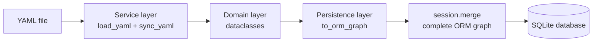
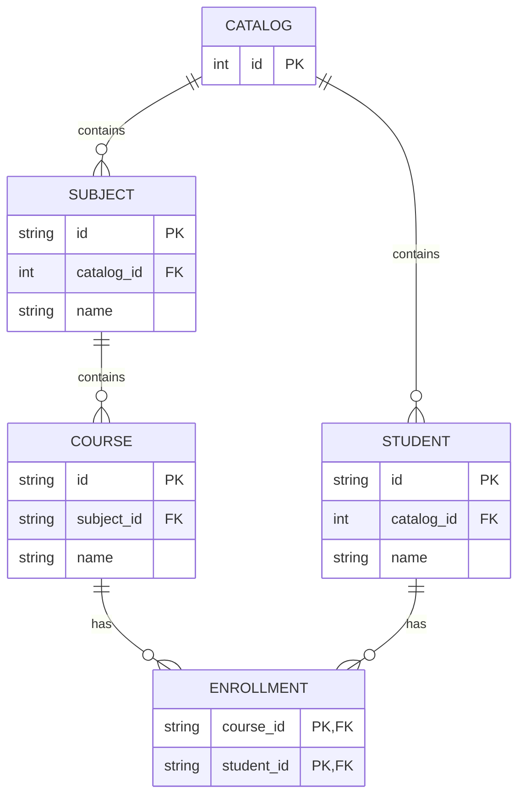

# CC YAML → SQLite POC

CC YAML → SQLite POC reads a complete YAML document into memory and synchronizes the
resulting object graph with SQLite using one SQLAlchemy `Session.merge()` call.
The YAML file is the source of truth.

## Architecture



## Object and database relationships



The relationship graph is navigable in both directions:

```python
student.courses
course.students
course.subject
student.enrollments
```

## Setup and usage

```bash
python3 -m venv .venv
source .venv/bin/activate
pip install -r requirements.txt
python app.py example.yaml
```

The database path is configured through an environment variable:

```bash
export CC_DATABASE=data.sqlite
python app.py example.yaml
```

If the variable is not set, `data.sqlite` is used.

Logging is configured with environment variables:

```bash
export CC_LOG_DESTINATION=file
export CC_LOG_FILE=course-control.log
python app.py example.yaml
```

`CC_LOG_DESTINATION` accepts `file` (the default) or `console`.

## Demonstrating additions and deletions

Each YAML file describes a complete state. Run the files in this order:

```bash
python app.py example.yaml
python app.py example-add.yaml
python app.py example-delete.yaml
```

`example-add.yaml` adds the `linear-algebra` course and the `s003` student.

`example-delete.yaml` omits the `programming` subject, the `python-basics`
course, and the `s002` enrollment. Because the relationships use
`all, delete-orphan`, missing objects are hard-deleted from SQLite.

## Project structure

```text
python/cc/
├── domain/       # domain dataclasses
├── persistence/  # SQLAlchemy models and merge operation
└── service/      # YAML loading and application workflow
```

The application-level entry point is:

```python
sync_yaml(yaml_file, database)
```

Inspect the result with:

```bash
sqlite3 data.sqlite 'select id, name from subjects;'
sqlite3 data.sqlite 'select * from enrollments;'
```
